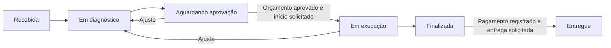
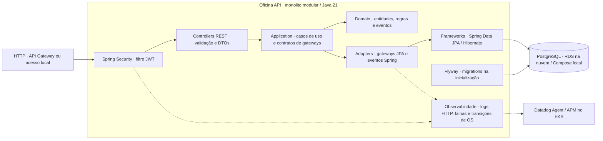

# Oficina API

API REST de gestão de oficina em Java e Spring Boot. Este repositório mantém regras de negócio, migrations Flyway, imagem Docker e deploy da aplicação no EKS. Para desenvolver localmente, basta este repositório e possuir Docker; os outros três são necessários para a implantação integrada na AWS.

## Contexto e problema do negócio

A solução atende ao fluxo de uma oficina mecânica de médio porte, desde o primeiro atendimento até a retirada do veículo. Processos espalhados em anotações manuais e planilhas dificultam localizar clientes e veículos, preservar históricos, controlar peças e acompanhar a aprovação de orçamentos.

O projeto centraliza essas informações em uma API: atendentes registram o atendimento, mecânicos informam diagnóstico e execução, e a gestão acompanha ordens de serviço, estoque e tempo médio de execução. Esses atores descrevem o processo de negócio; a autorização atual ainda não diferencia suas permissões por papel.

## Objetivo da fase atual

A evolução busca preparar a oficina para aumento de demanda, expansão do atendimento e horários de pico, com provisionamento reproduzível, entrega automatizada e visibilidade operacional. A implementação atual reúne:

- monolito modular em Clean Architecture, com testes e migrations versionadas;
- API no EKS, HPA de 2 a 6 réplicas e Cluster Autoscaler para capacidade dos nós;
- PostgreSQL privado no RDS, com backups e credencial gerenciada;
- login por CPF em Lambda, JWT e Authorizer no API Gateway;
- infraestrutura Terraform separada em componentes e ambientes;
- GitHub Actions para validação, publicação no GHCR e deploy;
- Datadog para métricas, logs, traces e alertas, com monitoramento externo descrito no guia de observabilidade.

Essa configuração oferece mecanismos de escala e recuperação. O RDS usa `multi_az=false` por padrão, e a rede usa um NAT Gateway. A expansão para novas unidades é uma motivação do projeto, sem cadastro ou isolamento por filial implementado.

## Navegação

Os guias abaixo complementam este README com instruções de execução, configuração e diagnóstico.

**Guias e documentos complementares**

- [Instalação das ferramentas](docs/INSTALACAO-FERRAMENTAS.md) — instalar ferramentas e conferir o ambiente.
- [Conta AWS comum](https://github.com/tc-organization-26/oficina-k8s-infra/blob/main/docs/CONTA-AWS-COMUM.md) — preparar IAM, OIDC e adaptar a execução fora do Academy.
- [Execução local](docs/EXECUCAO-LOCAL.md) — docker Compose, Java, testes e variáveis locais.
- [Execução no laboratório AWS](docs/EXECUCAO-LAB-AWS.md) — checklist GitHub, ordem dos projetos, deploy e destroy.
- [Tecnologias e versões](docs/VERSOES.md) — tecnologias, bibliotecas, ferramentas utilizadas e versões.
- [Referência da API](docs/API.md) — funcionalidades, métodos HTTP, rotas e autenticação.
- [Validação do fluxo completo](docs/VALIDACAO-FLUXO.md) — preparação do Insomnia, Run folder e cenários de negócio.
- [Arquitetura da solução](docs/ARQUITETURA-SOLUCAO.md) — componentes e sequências dos quatro projetos.
- [Arquitetura da aplicação](docs/ARQUITETURA-APLICACAO.md) — Clean Architecture, diagrama das camadas e decisões Java.
- [Decisões técnicas e arquiteturais](docs/decisions/README.md) — RFCs e ADRs com contexto, escolhas e consequências.
- [Arquitetura AWS](docs/architecture-diagram/README.md) — diagrama AWS, legenda e leitura dos componentes.
- [Modelo relacional](docs/modelo-relacional/README.md) — tabelas, relações e evolução do schema.
- [Observabilidade](docs/OBSERVABILIDADE.md) — métricas, logs, traces, alertas e validação da coleta.
- [Troubleshooting](docs/TROUBLESHOOTING.md) — diagnóstico local e AWS, com guias dos quatro componentes.

**Seções deste README**

- [Fluxo de atendimento](#fluxo-de-atendimento)
- [Status da ordem de serviço](#status-da-ordem-de-serviço)
- [Valor gerado](#valor-gerado)
- [Repositórios da solução](#repositórios-da-solução)
- [Execução e deploy](#execução-e-deploy)
- [Arquitetura](#arquitetura)
- [Decisões técnicas e arquiteturais](#decisões-técnicas-e-arquiteturais)
- [Recursos e acesso à API](#acesso-à-api)
- [Validação do fluxo completo](#validação-do-fluxo-completo)
- [Troubleshooting](#troubleshooting)

## Fluxo de atendimento

1. **Identificar o cliente.** O atendente consulta CPF/CNPJ e cadastra o cliente quando necessário. Consulta também os veículos vinculados e as ordens de serviço disponíveis para esse cliente.
2. **Selecionar o veículo.** Localiza o veículo cadastrado ou cria o vínculo com o cliente.
3. **Abrir a ordem de serviço.** Registra cliente, veículo, serviços, peças e anotações. A API gera UUID, número da OS e orçamento inicial, com status `RECEBIDA`. As listas de serviços e peças podem começar vazias.
4. **Realizar o diagnóstico.** Altera a OS para `EM_DIAGNOSTICO`, registra a avaliação técnica e compõe o orçamento com códigos do catálogo de serviços e estoque.
5. **Verificar peças.** Ao incluir peças no orçamento, o sistema consulta disponibilidade. A falta de peças publica um evento interno para acompanhamento, atualmente tratado por logs; essa etapa não reserva nem baixa estoque automaticamente.
6. **Enviar para aprovação.** Altera a OS para `AGUARDANDO_APROVACAO`, fechando o orçamento para decisão. A API registra aprovação ou recusa; a recusa não inicia a execução.
7. **Executar o serviço.** Com orçamento aprovado, altera a OS para `EM_EXECUCAO`. As retiradas de peças são registradas pela operação de baixa de estoque.
8. **Tratar ajustes.** Se for necessário revisar um orçamento enquanto a OS aguarda aprovação ou está em execução, altera a OS para `EM_DIAGNOSTICO`, reabrindo o orçamento. A reabertura atual limpa os itens de serviço e mantém os de peça; confira a composição e recadastre os serviços necessários. Após os ajustes, envia novamente para aprovação antes de retomar a execução.
9. **Finalizar e receber pagamento.** Altera a OS para `FINALIZADA` e registra o pagamento. O registro é uma confirmação interna; o projeto não integra uma adquirente ou processador de pagamentos.
10. **Entregar o veículo.** Com a OS finalizada e paga, altera para `ENTREGUE`. A consulta individual permite acompanhar os dados da ordem; a API também oferece tempo médio de execução.

As mudanças de etapa são chamadas explícitas à API. Aprovar o orçamento não inicia a execução automaticamente, e registrar pagamento não entrega o veículo. As notificações atuais são eventos internos com listeners de log, sem envio integrado de e-mail ou SMS. Os métodos, corpos e caminhos estão na [referência da API](docs/API.md).

## Status da ordem de serviço

| Status da API | Significado no atendimento |
| --- | --- |
| `RECEBIDA` | Atendimento e OS registrados |
| `EM_DIAGNOSTICO` | Avaliação técnica ou revisão de orçamento |
| `AGUARDANDO_APROVACAO` | Orçamento enviado, aguardando decisão |
| `EM_EXECUCAO` | Serviços em andamento após aprovação |
| `FINALIZADA` | Serviços concluídos, antes da entrega |
| `ENTREGUE` | Entrega registrada após confirmação de pagamento |

O orçamento possui estados próprios: `ABERTO`, `ENVIADO`, `APROVADO` e `RECUSADO`. Consulte o [modelo relacional e histórico de status](docs/modelo-relacional/README.md) para persistência e rastreabilidade.

## Valor gerado

- centralização de clientes, veículos, diagnósticos, orçamentos e ordens de serviço;
- rastreabilidade das mudanças de status e das peças incluídas nos atendimentos;
- controle explícito de aprovação, execução, pagamento e entrega;
- consulta e movimentação do estoque, com sinalização interna de indisponibilidade;
- acompanhamento do tempo médio de execução para apoiar a gestão;
- reprodução dos ambientes e redução de passos manuais de implantação;
- diagnóstico de falhas com logs, métricas, traces e alertas.

## Responsabilidades deste repositório

- implementar os casos de uso de clientes, veículos, serviços, estoque e ordens de serviço;
- expor a API REST e a documentação OpenAPI/Swagger;
- versionar o schema do PostgreSQL com Flyway;
- executar testes unitários e de integração;
- construir a imagem pelo [`Dockerfile`](Dockerfile), usada no Compose e no EKS, e publicá-la no GitHub Container Registry (GHCR);
- aplicar os manifests da API no EKS e acompanhar o rollout.

## Repositórios da solução

| Repositório | Responsabilidade |
| --- | --- |
| [gestao-oficina-tc-1](https://github.com/tc-organization-26/gestao-oficina-tc-1#readme) | API Java, migrations, Docker Compose e deploy da aplicação |
| [oficina-k8s-infra](https://github.com/tc-organization-26/oficina-k8s-infra#readme) | Bootstrap, rede, EKS, escalabilidade e entrada HTTP |
| [oficina-db-infra](https://github.com/tc-organization-26/oficina-db-infra#readme) | RDS PostgreSQL privado, backups e credencial gerenciada |
| [oficina-auth-lambda](https://github.com/tc-organization-26/oficina-auth-lambda#readme) | Login por CPF, JWT e rotas protegidas do Gateway |

## Execução e deploy

### Execução local

Consulte o [guia de execução local](docs/EXECUCAO-LOCAL.md) para executar o projeto em sua máquina utilizando Docker.

### Deploy e execução no laboratório AWS

Prepare o [checklist de acessos e configurações](docs/EXECUCAO-LAB-AWS.md#checklist-inicial) e conclua as dependências na [ordem de implantação](docs/EXECUCAO-LAB-AWS.md#ordem-da-primeira-implantação). Em cada um dos repositórios, faça o merge para `homologacao` para disparar o deploy em `hom` e aguarde a conclusão. Após validar homologação, faça merge para `main` em cada repositório, na mesma ordem dos componentes, para implantar `prod`.

> O código contém adaptações educacionais de IAM e credenciais. Confira a observação do guia AWS antes de utilizá-lo em outra conta.

## Arquitetura

### Componentes da aplicação

A [arquitetura integrada](docs/ARQUITETURA-SOLUCAO.md) apresenta detalhes sobre os quatro componentes e suas sequências.

## Decisões técnicas e arquiteturais

As [RFCs](docs/decisions/rfcs) descrevem as propostas técnicas, alternativas e impactos esperados. Os [ADRs](docs/decisions/adrs) registram o contexto, as decisões arquiteturais adotadas e suas consequências.

Consulte o [índice de decisões](docs/decisions/README.md) para acessar os documentos sobre AWS, PostgreSQL no RDS, autenticação com Lambda e JWT, comunicação HTTP/REST, EKS, HPA, rede privada, Flyway, separação de repositórios e states Terraform e observabilidade com Datadog.

## Acesso à API

- [Collection Insomnia](src/main/resources/insomnia/collection.yaml): inclui o login por CPF da Lambda (`POST /auth/login`) e os fluxos de negócio da API; configure `BASE_URL` e as variáveis do ambiente. Para execução local, adapte o login para `{login, senha}` conforme o [guia local](docs/EXECUCAO-LOCAL.md#login-e-chamada-protegida).
- Local: [Swagger](http://localhost:8081/swagger-ui/index.html) e [OpenAPI](http://localhost:8081/v3/api-docs).
- AWS: consulte o resumo da execução de deploy no [histórico do workflow](https://github.com/tc-organization-26/gestao-oficina-tc-1/actions/workflows/cicd.yml). A URL muda entre ambientes e recriações.
- Swagger/OpenAPI no Gateway exigem JWT. Para abrir a interface no navegador, siga o [acesso por túnel a HOM e PROD](docs/EXECUCAO-LAB-AWS.md#swagger-e-diagnóstico). Veja também os [passos de login, Authorize e GET /veiculos](docs/EXECUCAO-LOCAL.md#usar-o-swagger-local).

Mais sobre rotas e funcionalidades da API [aqui](docs/API.md).

## Validação do fluxo completo

Importe a [collection Insomnia](src/main/resources/insomnia/collection.yaml), configure o ambiente e execute a pasta **FLUXO COMPLETO** com **Run folder**, respeitando a ordem apresentada no runner. O [roteiro de demonstração](docs/VALIDACAO-FLUXO.md) explica login local ou AWS, cliente inicial, códigos e placa únicos, variáveis atualizadas pelos scripts e resultados esperados de cada etapa.

Além do caminho principal, o roteiro cobre recusa, revisão do orçamento, falta de peças e baixa de estoque como verificações separadas. O sucesso do deploy e do readiness deve ser complementado pela validação das operações de negócio.

## Banco e migrations

O [README do modelo relacional](docs/modelo-relacional/README.md) documenta os diagramas ER, as cardinalidades, chaves, campos e o histórico de status das ordens de serviço.

As migrations Flyway ficam em `src/main/resources/db/migration` e são executadas na inicialização da aplicação.

A infraestrutura do RDS, no repositório `oficina-db-infra`, não cria tabelas de negócio; ela entrega somente a instância, a rede e a credencial.

No deploy em nuvem, o workflow obtém:

- endpoint e nome do banco pelo AWS Systems Manager Parameter Store;
- usuário e senha pelo AWS Secrets Manager;
- segredo JWT pelo Secrets Manager criado pelo repositório da Lambda.

Esses valores são transformados em `ConfigMap` e `Secret` no namespace `oficina`.

## Manifests Kubernetes

O diretório `k8s/cloud` contém apenas os recursos da aplicação:

- `namespace.yaml`: namespace `oficina`;
- `deployment.yaml`: dois Pods iniciais, probes e limites de recursos;
- `service.yaml`: Service `NodePort` na porta fixa `30081`;
- `hpa.yaml`: escala a aplicação de 2 a 6 réplicas por CPU e memória.

O cluster, o Metrics Server e o Cluster Autoscaler são criados pelo repositório `oficina-k8s-infra`.

## Observabilidade

O deploy da API instala a observabilidade Datadog no EKS e configura dashboards e alertas. O [guia de observabilidade](docs/OBSERVABILIDADE.md) descreve a coleta de métricas, logs e traces, o monitoramento externo, a validação da coleta em `hom` e `prod` e o [teste de falha em pod temporário](docs/OBSERVABILIDADE.md#validar-a-coleta).

## Workflow

- [Workflow deste componente](.github/workflows/cicd.yml).
- [Histórico de execuções](https://github.com/tc-organization-26/gestao-oficina-tc-1/actions/workflows/cicd.yml).

### Fluxo de branches

`fase-3` valida e abre PR para `homologacao`; `homologacao` faz deploy em `hom` e abre PR para `main`; `main` faz deploy em `prod`. Os merges são manuais. Executar manualmente em `fase-3` também só valida. Consulte [branches e ambientes](docs/EXECUCAO-LAB-AWS.md#branches-e-ambientes).

## Troubleshooting

Os guias reúnem sintomas, comandos de diagnóstico e correções por assunto. Consulte o componente que apresenta a falha:

| Componente | Guia de diagnóstico |
| --- | --- |
| Aplicação | [Troubleshooting da Oficina API](docs/TROUBLESHOOTING.md) |
| Plataforma | [Bootstrap, EKS, rede, NLB e API Gateway](https://github.com/tc-organization-26/oficina-k8s-infra/blob/main/docs/TROUBLESHOOTING.md) |
| Banco | [RDS, conectividade, credenciais, backups e snapshots](https://github.com/tc-organization-26/oficina-db-infra/blob/main/docs/TROUBLESHOOTING.md) |
| Autenticação | [Python, Lambda, login por CPF e Authorizer](https://github.com/tc-organization-26/oficina-auth-lambda/blob/main/docs/TROUBLESHOOTING.md) |
