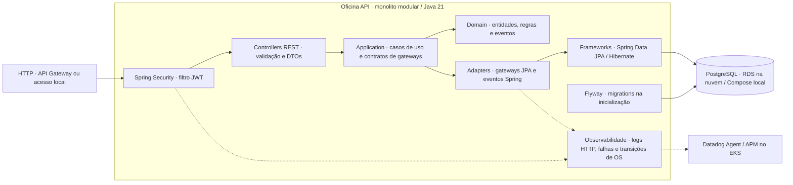

# Oficina API

API REST de gestão de oficina em Java e Spring Boot. Este repositório mantém regras de negócio, migrations Flyway, imagem Docker e deploy da aplicação no EKS. Para desenvolver localmente, basta este repositório e possuir Docker; os outros três são necessários para a implantação integrada na AWS.

## Responsabilidades deste repositório

- implementar os casos de uso de clientes, veículos, serviços, estoque e ordens de serviço;
- expor a API REST e a documentação OpenAPI/Swagger;
- versionar o schema do PostgreSQL com Flyway;
- executar testes unitários e de integração;
- construir a imagem pelo [`Dockerfile`](Dockerfile), usada no Compose e no EKS, e publicá-la no GitHub Container Registry (GHCR);
- aplicar os manifests da API no EKS e acompanhar o rollout.

## Índice da documentação

| Assunto | Documento |
| --- | --- |
| Docker Compose, Java, testes e variáveis locais | [Execução local](docs/EXECUCAO-LOCAL.md) |
| Checklist GitHub, ordem dos projetos, deploy e encerramento | [Execução na AWS](docs/EXECUCAO-AWS.md) |
| Tecnologias, bibliotecas, ferramentas utilizadas e versões | [Tecnologias e versões](docs/VERSOES.md) |
| Funcionalidades, métodos HTTP, rotas e autenticação | [Referência da API](docs/API.md) |
| Componentes e sequências dos quatro projetos | [Arquitetura da solução](docs/ARQUITETURA-SOLUCAO.md) |
| Camadas e decisões Java | [Arquitetura interna](docs/ARQUITETURA-APLICACAO.md) |
| Diagrama AWS, legenda e leitura dos componentes | [Arquitetura AWS](docs/architecture-diagram/README.md) |
| Tabelas, relações e evolução do schema | [Modelo relacional](docs/modelo-relacional/README.md) |
| Métricas, logs, traces, alertas e validação da coleta | [Observabilidade](docs/OBSERVABILIDADE.md) |
| Diagnóstico local e AWS, com guias dos quatro componentes | [Troubleshooting](docs/TROUBLESHOOTING.md) |

## Repositórios da solução

| Repositório | Responsabilidade |
| --- | --- |
| [gestao-oficina-tc-1](https://github.com/tc-organization-26/gestao-oficina-tc-1#readme) | API Java, migrations, Docker Compose e deploy da aplicação |
| [oficina-k8s-infra](https://github.com/tc-organization-26/oficina-k8s-infra#readme) | Bootstrap, rede, EKS, escalabilidade e entrada HTTP |
| [oficina-db-infra](https://github.com/tc-organization-26/oficina-db-infra#readme) | RDS PostgreSQL privado, backups e credencial gerenciada |
| [oficina-auth-lambda](https://github.com/tc-organization-26/oficina-auth-lambda#readme) | Login por CPF, JWT e rotas protegidas do Gateway |

## Execução e deploy

### Execução local

Consulte o [guia de execução local](docs/EXECUCAO-LOCAL.md) para executar o projeto em sua máquina utilizando Docker.

### Deploy e execução na AWS

Prepare o [checklist de acessos e configurações](docs/EXECUCAO-AWS.md#checklist-inicial) e conclua as dependências na [ordem de implantação](docs/EXECUCAO-AWS.md#ordem-da-primeira-implantação). Em cada um dos repositórios, faça o merge para `homologacao` para disparar o deploy em `hom` e aguarde a conclusão.

> O código contém adaptações educacionais de IAM e credenciais. Confira a observação do guia AWS antes de utilizá-lo em outra conta.

## Arquitetura

A [arquitetura integrada](docs/ARQUITETURA-SOLUCAO.md) apresenta detalhes sobre os quatro componentes e suas sequências.

## Acesso à API

- [Collection Insomnia](src/main/docs/insomnia/collection.yaml): os logins usam CPF para AWS; configure `BASE_URL` e as variáveis do ambiente. Para execução local, adapte o login para `{login, senha}` conforme o [guia local](docs/EXECUCAO-LOCAL.md#login-e-chamada-protegida).
- Local: [Swagger](http://localhost:8081/swagger-ui/index.html) e [OpenAPI](http://localhost:8081/v3/api-docs).
- AWS: consulte os [deployments](https://github.com/tc-organization-26/gestao-oficina-tc-1/deployments) ou o resumo da execução do workflow. A URL muda entre ambientes e recriações.
- Swagger/OpenAPI no Gateway exigem JWT. Para abrir a interface diretamente no navegador, use o port-forward do guia AWS.

Mais sobre rotas e funcionalidades da API [aqui](docs/API.md).

## Banco e migrations

O [README do modelo relacional](docs/modelo-relacional/README.md) documenta os diagramas ER, as cardinalidades, chaves, campos e o histórico de status das ordens de serviço.

As migrations Flyway ficam em `src/main/resources/db/migration` e são executadas na inicialização da aplicação.

A infraestrutura do RDS, no repositório `oficina-db-infra`, não cria tabelas de negócio; ela entrega somente a instância, a rede e a credencial.

No deploy em nuvem, o workflow obtém:

- endpoint e nome do banco pelo AWS Systems Manager Parameter Store;
- usuário e senha pelo AWS Secrets Manager;
- segredo JWT pelo Secrets Manager criado pelo repositório da Lambda.

Esses valores são transformados em `ConfigMap` e `Secret` no namespace `oficina`.

## Manifests Kubernetes

O diretório `k8s/cloud` contém apenas os recursos da aplicação:

- `namespace.yaml`: namespace `oficina`;
- `deployment.yaml`: dois Pods iniciais, probes e limites de recursos;
- `service.yaml`: Service `NodePort` na porta fixa `30081`;
- `hpa.yaml`: escala a aplicação de 2 a 6 réplicas por CPU e memória.

O cluster, o Metrics Server e o Cluster Autoscaler são criados pelo repositório `oficina-k8s-infra`.

## Observabilidade

O deploy da API instala a observabilidade Datadog no EKS e configura dashboards e alertas. O [guia de observabilidade](docs/OBSERVABILIDADE.md) descreve a coleta de métricas, logs e traces, o monitoramento externo e o [teste de validação em homologação](docs/OBSERVABILIDADE.md#validar-a-coleta).

## Workflow

- [Workflow deste componente](.github/workflows/cicd.yml).
- [Histórico de execuções](https://github.com/tc-organization-26/gestao-oficina-tc-1/actions/workflows/cicd.yml).

### Fluxo de branches

`fase-3` valida e abre PR para `homologacao`; `homologacao` faz deploy em `hom` e abre PR para `main`; `main` faz deploy em `prod`. Os merges são manuais. Executar manualmente em `fase-3` também só valida. Consulte [branches e ambientes](docs/EXECUCAO-AWS.md#branches-e-ambientes).

## Troubleshooting

Os guias reúnem sintomas, comandos de diagnóstico e correções por assunto. Consulte o componente que apresenta a falha:

| Componente | Guia de diagnóstico |
| --- | --- |
| Aplicação | [Troubleshooting da Oficina API](docs/TROUBLESHOOTING.md) |
| Plataforma | [Bootstrap, EKS, rede, NLB e API Gateway](https://github.com/tc-organization-26/oficina-k8s-infra/blob/HEAD/docs/TROUBLESHOOTING.md) |
| Banco | [RDS, conectividade, credenciais, backups e snapshots](https://github.com/tc-organization-26/oficina-db-infra/blob/HEAD/docs/TROUBLESHOOTING.md) |
| Autenticação | [Python, Lambda, login por CPF e Authorizer](https://github.com/tc-organization-26/oficina-auth-lambda/blob/HEAD/docs/TROUBLESHOOTING.md) |