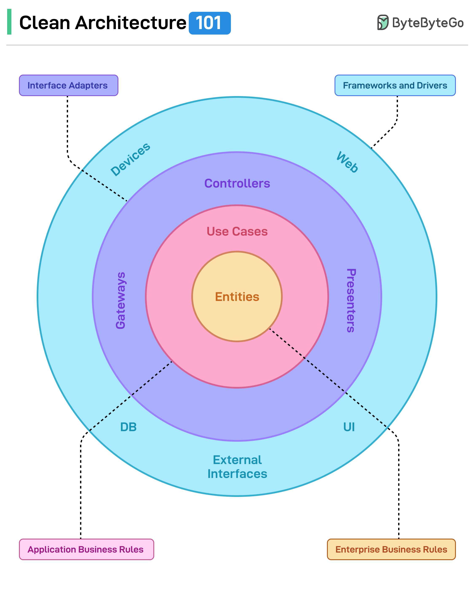
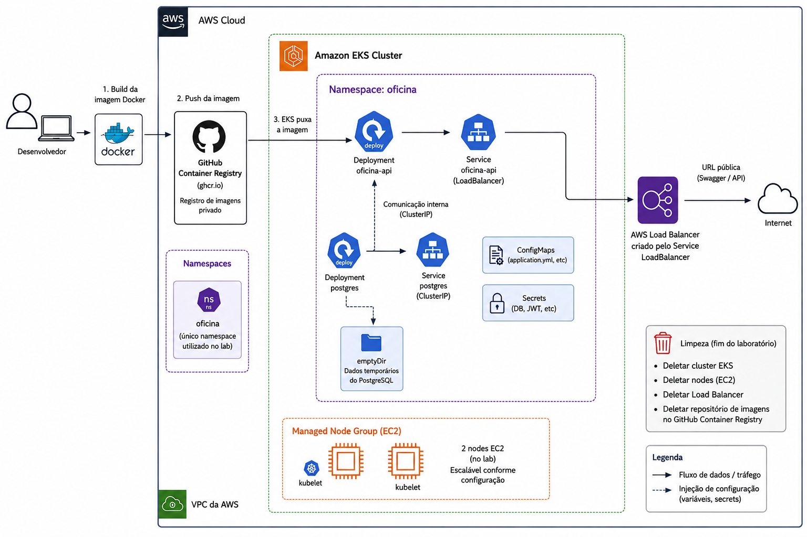

# Oficina API

Aplicação principal do sistema de gestão de uma oficina mecânica. Este repositório concentra as regras de negócio, a API REST, as migrations do banco, a imagem Docker e os manifests Kubernetes usados para executar a aplicação no Amazon EKS.

Este é um dos quatro repositórios da solução. Ele **não provisiona** VPC, EKS, API Gateway, RDS ou Lambda; essas responsabilidades pertencem aos repositórios de infraestrutura.

> Para implantar no ambiente educacional com `LabRole` e credenciais temporárias, consulte [Execução no AWS Lab](docs/EXECUCAO-LAB.md).

## Links de deploy e documentação da API

- [Deployments ativos](https://github.com/tc-organization-26/gestao-oficina-tc-1/deployments): cada execução bem-sucedida registra a URL real do API Gateway para homologação ou produção.
- [Pipeline CI/CD](https://github.com/tc-organization-26/gestao-oficina-tc-1/actions/workflows/cicd.yml).
- Swagger local: [http://localhost:8081/swagger-ui/index.html](http://localhost:8081/swagger-ui/index.html).
- OpenAPI local: [http://localhost:8081/v3/api-docs](http://localhost:8081/v3/api-docs).
- Swagger publicado: use o link do deployment ativo e acrescente `/swagger-ui/index.html`.
- [Collection Insomnia](src/main/resources/collection-insomnia.yaml), importável também no Postman.

A URL AWS não é fixada no código porque o identificador do API Gateway muda entre contas e recriações. O workflow publica a URL efetivamente implantada no GitHub Deployment e no resumo da execução.

## Dockerfile

O Dockerfile é aplicável neste repositório e está em [`Dockerfile`](Dockerfile). Ele gera a imagem da aplicação usada tanto pelo Docker Compose local quanto pelo deploy no EKS.

## Responsabilidades deste repositório

- implementar os casos de uso de clientes, veículos, serviços, estoque e ordens de serviço;
- expor a API REST e a documentação OpenAPI/Swagger;
- versionar o schema do PostgreSQL com Flyway;
- executar testes unitários e de integração;
- construir a imagem Docker e publicá-la no GitHub Container Registry (GHCR);
- aplicar os manifests da API no EKS e acompanhar o rollout.

## Arquitetura da solução

| Repositório | Responsabilidade |
| --- | --- |
| `gestao-oficina-tc-1` | Aplicação Spring Boot, Docker, GHCR e deploy no EKS |
| `oficina-k8s-infra` | Bootstrap, backend Terraform, VPC, EKS, escalabilidade e API Gateway |
| `oficina-db-infra` | Amazon RDS for PostgreSQL, rede do banco e credencial gerenciada |
| `oficina-auth-lambda` | Login serverless, geração de JWT e Lambda Authorizer |

Na nuvem, o tráfego segue este caminho:

```text
Cliente
  -> API Gateway
     -> POST /auth/login -> Lambda de login
     -> demais rotas -> Lambda Authorizer -> VPC Link -> NLB privado
        -> Service NodePort 30081 -> Pods da Oficina API no EKS
           -> RDS PostgreSQL privado
```

O código da aplicação segue Clean Architecture. A organização dos pacotes está detalhada em [`docs/ARQUITETURA.md`](docs/ARQUITETURA.md).





## Funcionalidades

- cadastro, consulta, atualização e exclusão de clientes;
- pesquisa de cliente por CPF ou CNPJ;
- cadastro e consulta de veículos vinculados ao cliente;
- catálogo de serviços da oficina;
- cadastro e movimentação de peças e insumos do estoque;
- abertura e acompanhamento de ordens de serviço;
- registro de diagnóstico;
- composição de orçamento com serviços e peças;
- aprovação ou recusa de orçamento;
- registro de pagamento;
- acompanhamento do tempo médio de execução.

### Estados da ordem de serviço

- `Recebida`: atendimento registrado;
- `Em diagnóstico`: veículo em avaliação;
- `Aguardando aprovação`: orçamento aguardando decisão do cliente;
- `Em execução`: orçamento aprovado e serviço iniciado;
- `Finalizada`: serviços concluídos;
- `Entregue`: pagamento e retirada concluídos.

## Principais rotas

| Rota | Finalidade |
| --- | --- |
| `POST /auth/login` | Login local da aplicação; na nuvem o API Gateway direciona esta rota à Lambda |
| `/clientes` | CRUD e listagem de clientes |
| `/clientes/documento/{cpfCnpj}` | Consulta por documento |
| `/clientes/{id}/veiculos` | Veículos de um cliente |
| `/veiculos` | CRUD de veículos |
| `/servicos` | CRUD de serviços |
| `/estoque` | CRUD e consultas de estoque |
| `/estoque/{id}/inclusoes` | Entrada de quantidade no estoque |
| `/estoque/{codigo}/baixas` | Baixa de quantidade no estoque |
| `/ordens-servico` | Criação, listagem e detalhamento de ordens |
| `/ordens-servico/{id}/diagnostico` | Registro do diagnóstico |
| `/ordens-servico/{id}/status` | Consulta ou atualização de status |
| `/ordens-servico/{id}/orcamento/*` | Composição e decisão do orçamento |
| `/ordens-servico/{id}/pagamento` | Registro do pagamento |
| `/swagger-ui/index.html` | Interface Swagger |

A collection para Insomnia está em [`src/main/resources/collection-insomnia.yaml`](src/main/resources/collection-insomnia.yaml).

## Tecnologias principais

- Java 21;
- Spring Boot 4;
- Spring Web MVC, Spring Data JPA e Spring Security;
- PostgreSQL;
- Flyway;
- Maven;
- Docker e Docker Compose;
- Kubernetes;
- GitHub Actions e GitHub Container Registry.

## Execução local com Docker Compose

Pré-requisitos:

- Docker Desktop;
- Docker Compose v2.

Crie o arquivo de variáveis a partir do exemplo:

```powershell
Copy-Item .env.example .env
```

Preencha ao menos `POSTGRES_PASSWORD` e `JWT_SECRET`. Depois execute:

```powershell
docker compose up --build
```

Serviços locais:

- API: `http://localhost:8081`
- Swagger: `http://localhost:8081/swagger-ui/index.html`
- PostgreSQL: `localhost:5433`

Para encerrar:

```powershell
docker compose down
```

Para apagar também o volume do PostgreSQL local:

```powershell
docker compose down --volumes
```

O volume do Docker Compose existe apenas para desenvolvimento. O ambiente de nuvem usa RDS e não utiliza PVC para o banco.

## Variáveis da aplicação

| Variável | Uso | Exemplo local |
| --- | --- | --- |
| `SERVER_PORT` | Porta HTTP | `8081` |
| `SPRING_DATASOURCE_URL` | JDBC do PostgreSQL | `jdbc:postgresql://postgres:5432/oficina_db_2` |
| `SPRING_DATASOURCE_USERNAME` | Usuário do banco | `postgres` |
| `POSTGRES_PASSWORD` | Senha do banco | Definida em `.env` |
| `SPRING_JPA_HIBERNATE_DDL_AUTO` | Estratégia do Hibernate | `none` |
| `SPRING_FLYWAY_BASELINE_ON_MIGRATE` | Habilita baseline | `true` |
| `SPRING_FLYWAY_BASELINE_VERSION` | Versão do baseline | `0` |
| `SPRING_FLYWAY_VALIDATE_ON_MIGRATE` | Valida migrations | `true` |
| `SECURITY_JWT_SECRET` ou `JWT_SECRET` | Assinatura HS256 | Chave com pelo menos 32 bytes |
| `SECURITY_JWT_EXPIRATION_SECONDS` | Validade do token | `3600` |

Não versione o arquivo `.env`.

## Build e testes

Pré-requisitos para executar fora do Docker:

- Java 21;
- PostgreSQL disponível em `localhost:5433` para os testes de integração.

```powershell
docker compose up -d postgres
./mvnw.cmd clean verify
```

O CI executa o mesmo ciclo Maven com um PostgreSQL 16 temporário.

## Banco e migrations

As migrations Flyway ficam em `src/main/resources/db/migration` e são executadas na inicialização da aplicação. A infraestrutura do RDS não cria tabelas de negócio; ela entrega somente a instância, a rede e a credencial.

No deploy em nuvem, o workflow obtém:

- endpoint e nome do banco pelo AWS Systems Manager Parameter Store;
- usuário e senha pelo AWS Secrets Manager;
- segredo JWT pelo Secrets Manager criado pelo repositório da Lambda.

Esses valores são transformados em `ConfigMap` e `Secret` no namespace `oficina`.

## Manifests Kubernetes

O diretório `k8s/cloud` contém apenas os recursos da aplicação:

- `namespace.yaml`: namespace `oficina`;
- `deployment.yaml`: dois Pods iniciais, probes e limites de recursos;
- `service.yaml`: Service `NodePort` na porta fixa `30081`;
- `hpa.yaml`: escala a aplicação de 2 a 6 réplicas por CPU e memória.

O cluster, o Metrics Server e o Cluster Autoscaler são criados pelo repositório `oficina-k8s-infra`.

## CI/CD

O workflow `.github/workflows/cicd.yml` possui três etapas:

1. `testes`: inicia PostgreSQL 16 e executa `./mvnw clean verify`;
2. `publicar`: constrói a imagem e publica `ghcr.io/OWNER/REPOSITORY:COMMIT_SHA`;
3. `deploy`: assume uma role AWS por OIDC, monta a configuração da aplicação, aplica os manifests e aguarda o rollout.

Mapeamento de branches:

| Branch | Ambiente Terraform/SSM | GitHub Environment |
| --- | --- | --- |
| `homologacao` | `hom` | `homologacao` |
| `main` ou `master` | `prod` | `producao` |

### Configuração do GitHub

Variables configuradas pelo bootstrap:

- `AWS_ROLE_ARN`
- `AWS_REGION`

Secrets necessários para baixar uma imagem privada no cluster:

- `GHCR_USERNAME`
- `GHCR_TOKEN`, com permissão `read:packages`

O `GITHUB_TOKEN` fornecido pelo Actions é usado para publicar a imagem no GHCR.

## Ordem de implantação

1. Executar o bootstrap em `oficina-k8s-infra`.
2. Provisionar `oficina-k8s-infra`.
3. Provisionar `oficina-db-infra`.
4. Publicar `oficina-auth-lambda`.
5. Executar o CI/CD deste repositório.

## Validação após o deploy

```powershell
kubectl get deployment,service,hpa -n oficina
kubectl rollout status deployment/oficina-api -n oficina --timeout=300s
```

Para diagnóstico administrativo sem passar pelo API Gateway:

```powershell
kubectl port-forward -n oficina service/oficina-api 18081:8081
```

Abra `http://localhost:18081/swagger-ui/index.html`.

## Estrutura relevante

```text
.
├── .github/workflows/cicd.yml
├── docs/
├── k8s/cloud/
├── src/main/java/
├── src/main/resources/db/migration/
├── src/test/
├── src/integrationTest/
├── docker-compose.yml
├── Dockerfile
└── pom.xml
```

## Documentação complementar

- [`docs/ARQUITETURA.md`](docs/ARQUITETURA.md): organização interna e decisões de arquitetura;
- [`docs/EXECUCAO.md`](docs/EXECUCAO.md): roteiro resumido de execução e implantação;
- [`docs/TROUBLESHOOTING.md`](docs/TROUBLESHOOTING.md): diagnóstico dos problemas mais comuns.
