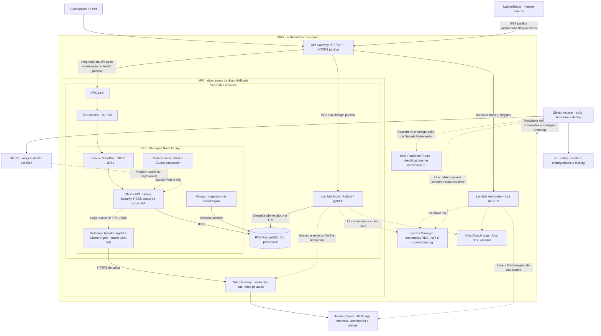
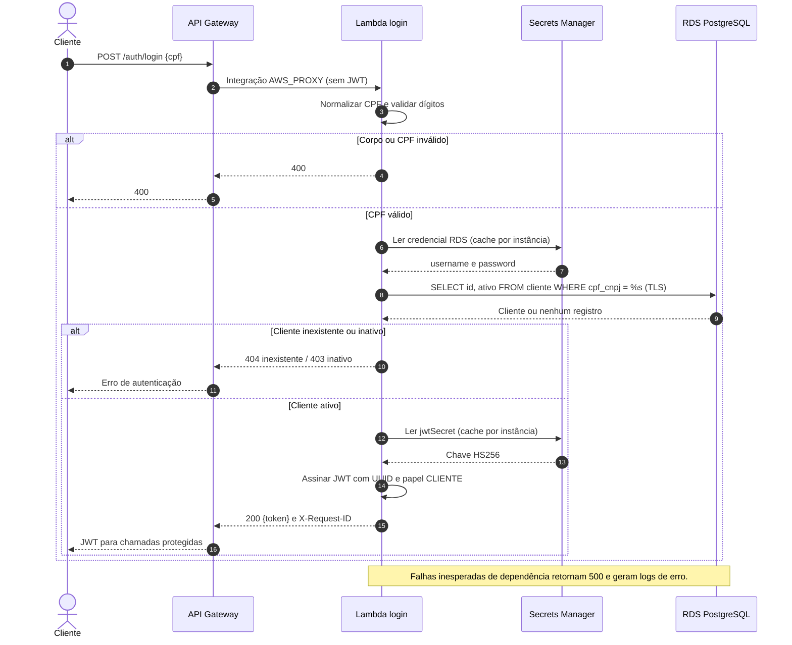
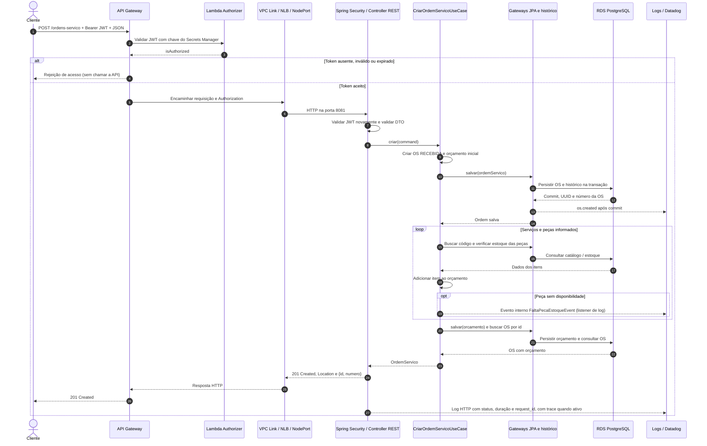

# Arquitetura da solução

[README](../README.md) · [Referência da API](API.md)

Esta seção concentra a visão integrada dos quatro repositórios. A [arquitetura do código](ARQUITETURA-APLICACAO.md) da aplicação detalha as camadas Java; o [guia Datadog](OBSERVABILIDADE.md) contém configuração, dashboards e validação da coleta.

## Diagrama de componentes da aplicação

As setas contínuas representam chamadas e transferências; as tracejadas, configuração, coleta e controle. O Authorizer devolve a decisão ao Gateway; quem encaminha a chamada à API é a integração VPC Link. RDS, NLB, nós e Pods não possuem entrada pública da aplicação. O endpoint administrativo do EKS é público para o deploy pelo Actions.

## Contratos, segurança e persistência

- **Entrada:** `POST /auth/login`, `GET /actuator/health` e `GET /actuator/health/readiness` são públicos no Gateway. As rotas genéricas `ANY /` e `ANY /{proxy+}` exigem autorização `CUSTOM`, inclusive para Swagger/OpenAPI.
- **Identidade:** a Lambda normaliza e valida o CPF, consulta `cliente.cpf_cnpj` e exige cliente ativo. Emite JWT HS256 com `sub` igual ao UUID, `papel=CLIENTE`, `iat` e `exp` (3600 segundos por padrão). O Authorizer e o filtro Spring validam o token com a mesma chave. O login por CPF é o mecanismo de demonstração atual; não comprova posse de senha ou segundo fator.
- **Autorização atual:** o Spring exige autenticação nas rotas de negócio, sem regras por papel ou comparação automática entre `sub` e `clienteId` do corpo. O diagrama não pressupõe isolamento de dados por cliente.
- **Dados:** a API e a Lambda de login compartilham o RDS. O repositório do banco libera o SG dos nós; o da autenticação acrescenta a regra para seu próprio SG. Somente a API executa migrations Flyway. A senha do RDS é gerenciada no Secrets Manager; o workflow da API copia a configuração necessária para ConfigMap/Secret Kubernetes.
- **Integração dos repositórios:** SSM publica rede, cluster, entrada HTTP e localização do banco/secret. Os states são separados por componente e ambiente no S3; `homologacao` usa `hom` e `main` usa `prod`.
- **Escala e disponibilidade:** HPA mantém 2–6 réplicas por CPU/memória; Cluster Autoscaler ajusta os nós (1–4 por padrão). O RDS usa `multi_az=false` por padrão; duas AZs na rede não significam standby do banco. Backups têm retenção padrão de sete dias e snapshot final na remoção.

O schema disponibiliza o CPF fictício `003.619.370-40` (`00361937040` no banco), UUID `00000000-0000-0000-0000-000000000001` como cliente ativo para testes. A API também oferece cadastro de clientes. Aguarde o startup com Flyway antes de testar o login.

## Sequência de autenticação

Contrato completo e exemplos de erros estão na [referência da autenticação](https://github.com/tc-organization-26/oficina-auth-lambda/blob/HEAD/README.md#acesso-à-api). Neste repositório, `POST /auth/login` é atendido pelo Java e recebe `{login, senha}`; a Lambda por CPF é a integração usada na nuvem.

## Sequência de abertura de ordem de serviço

Pré-condições: migrations aplicadas, cliente e veículo cadastrados e códigos de serviços/peças existentes quando informados. O corpo recebe `clienteId`, `veiculoId`, listas obrigatórias `servicos` e `pecas` (podem ser vazias) e `anotacoes` opcional. Cada item contém `codigo` e `quantidade` maior ou igual a `0.001`.

O diagrama mostra o caminho de sucesso após a validação. DTO inválido gera `400`; código inexistente ou outra `DomainException` gera `422`; falhas técnicas podem gerar `500`. A indisponibilidade de peça publica um evento, sem bloquear automaticamente a abertura ou efetuar a baixa do estoque nessa etapa.

## Monitoramento e limites operacionais

Na aplicação, o Datadog acompanha logs, traces e métricas para ajudar a observar requisições, saúde da aplicação e acesso ao PostgreSQL. Os endpoints de healthcheck mostram se a API está disponível. Consulte o [guia operacional de observabilidade](OBSERVABILIDADE.md) para mais informações.
