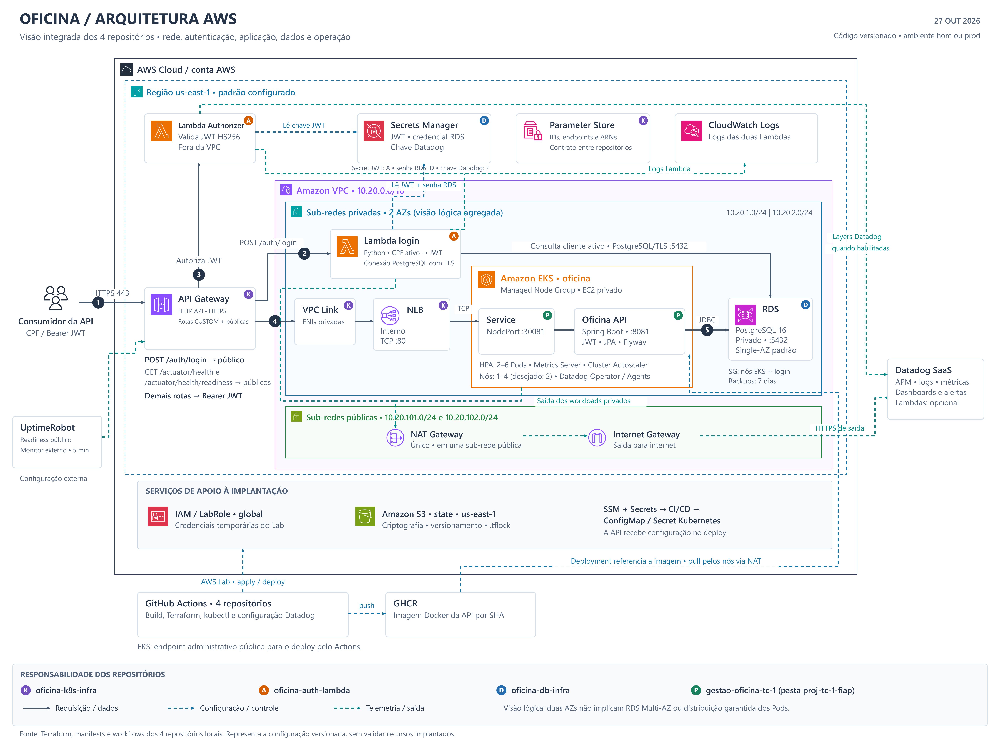

# Diagrama integrado da arquitetura AWS

[README da API](../../README.md) · [Índice de documentação](../../README.md#navegação)

O diagrama a seguir foi construído com base nesta solução, que consiste em quatro repositórios. Representa os recursos e fluxos do projeto.

Homologação (`hom`) e produção (`prod`) seguem o mesmo desenho lógico em implantações separadas.

## Legenda de símbolos para repositórios

| Identificador | Repositório | Arquivos consultados |
| --- | --- | --- |
| K | `oficina-k8s-infra` | `main.tf`, `edge.tf`, `autoscaling.tf`, `variables.tf`, `bootstrap/state.tf`, `bootstrap/oidc.tf`, workflows e README |
| D | `oficina-db-infra` | `main.tf`, `variables.tf`, workflow Terraform |
| A | `oficina-auth-lambda` | `terraform/main.tf`, `terraform/datadog.tf`, `src/handler.py`, workflow CI/CD |
| P | `gestao-oficina-tc-1` | `k8s/cloud/*`, `k8s/observability/datadog-agent.yaml`, `observability/datadog/*`, `.github/workflows/cicd.yml`, `src/main/resources/application.properties`, README |

## Observações importantes para melhor leitura do diagrama de arquitetura

- Limites aninhados para conta AWS, região, VPC, sub-redes e workloads EKS. Os serviços gerenciados regionais API Gateway, Secrets Manager, SSM e CloudWatch aparecem fora da VPC. O Authorizer não possui configuração VPC; a Lambda de login possui.
- As duas sub-redes privadas são agregadas em uma visão lógica. Não se afirma uma AZ específica para cada recurso nem uma distribuição de Pods que os manifests não garantem.
- O RDS é Single-AZ por padrão, mesmo com um subnet group em duas AZs. O NAT é único e ocupa uma das sub-redes públicas.
- O VPC Link representa as ENIs da integração privada. O Gateway chama o Authorizer e recebe sua decisão; a requisição de negócio segue do Gateway pelo VPC Link e NLB. As respostas percorrem o caminho de volta, omitido por legibilidade.
- Somente o login consulta cliente ativo para emitir o JWT. O Authorizer valida JWT e lê a chave compartilhada. A aplicação valida o JWT novamente e executa Flyway na inicialização.
- O SG do RDS permite PostgreSQL a partir do SG dos nós EKS e do SG da Lambda de login. O diagrama não implica acesso público ao banco.
- As setas azuis representam leitura de configuração e implantação. Os workflows da API leem SSM e Secrets Manager e criam ConfigMap/Secret Kubernetes. Não se pressupõe que os Pods leiam Secrets Manager diretamente.
- Os workflows atuais usam credenciais temporárias da AWS e uma role preexistente (`LabRole` na configuração educacional). Embora exista código de bootstrap OIDC, o desenho não o apresenta como mecanismo ativo de autenticação do CI/CD.
- GHCR e GitHub Actions ficam fora da AWS. Os nós obtêm a imagem GHCR pela saída NAT. O endpoint administrativo EKS é público para implantação.
- Datadog Operator/Agents e tracer Java pertencem ao deploy da API. As layers Datadog das Lambdas são condicionais; logs Lambda também seguem para CloudWatch. UptimeRobot é configurado externamente.
- Os marcadores de repositório indicam responsabilidade predominante. Secrets Manager tem responsabilidade compartilhada, detalhada abaixo do componente.
- IAM é global. O quadro de apoio está fora do contorno regional por conter serviços de escopos diferentes; o bucket S3 é identificado com sua região padrão.
