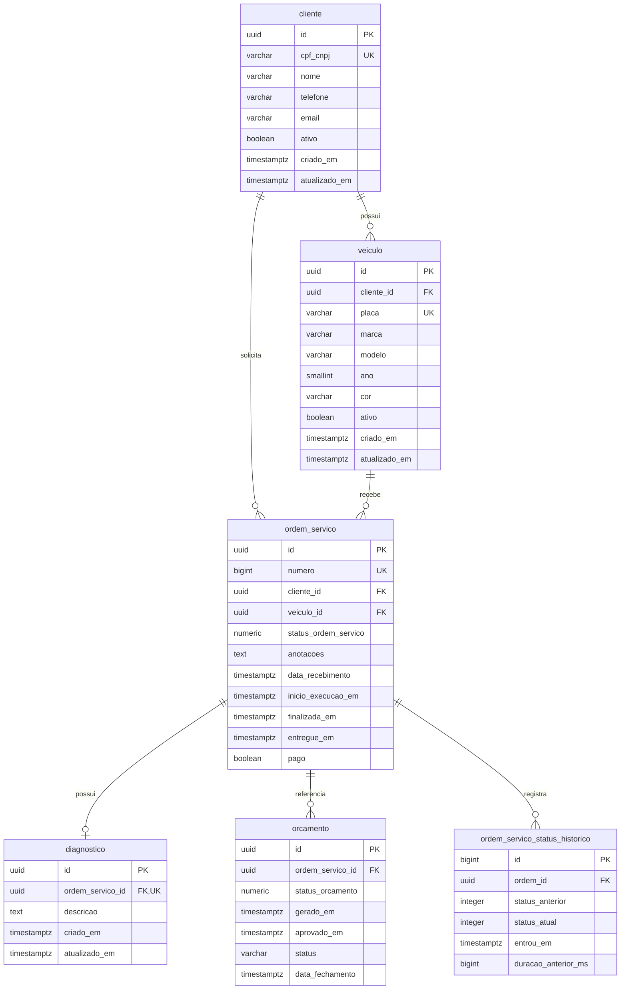
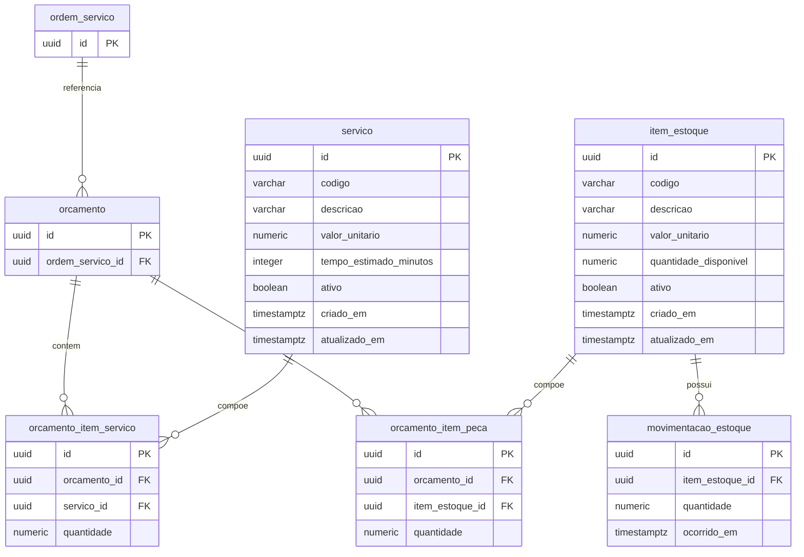

# Modelo relacional do banco Oficina

[README da API](../../README.md) · [Índice de documentação](../../README.md#índice-da-documentação)

Este documento descreve o schema PostgreSQL resultante das [migrations Flyway](../../src/main/resources/db/migration), executadas pela API na inicialização.

A documentação fica neste repositório porque ele mantém o schema; o [oficina-db-infra](https://github.com/tc-organization-26/oficina-db-infra#readme) provisiona o RDS, rede, backups e credencial.

Os diagramas representam o modelo relacional. São 11 tabelas de negócio; a tabela técnica `flyway_schema_history`, mantida pelo Flyway, não aparecerá nos diagramas.

O PostgreSQL em nuvem é um RDS privado, compartilhado pela API e pela Lambda de login, com armazenamento criptografado, backups e senha gerenciada no Secrets Manager. Esse provisionamento pertence ao `oficina-db-infra`; a criação/evolução das tabelas continua sob responsabilidade do Flyway da API. Consulte a [referência de infraestrutura](https://github.com/tc-organization-26/oficina-db-infra/blob/HEAD/docs/REFERENCIA.md#recursos-criados) para os parâmetros operacionais.

Observação: Na V4, cada OS passa a ter um histórico persistente para calcular o tempo em cada status e alimentar a observabilidade. Não são recriados clientes, veículos, orçamentos ou ordens existentes, nem preenchidos tempos históricos anteriores à migration.

## Como ler os diagramas ER

`PK` indica chave primária, `FK` chave estrangeira e `UK` unicidade. `||` significa exatamente um, `o|` zero ou um e `o{` zero ou muitos. Toda FK deste schema é obrigatória (`NOT NULL`); a opcionalidade está na possibilidade de o pai ainda não possuir filhos. Os tipos SQL e campos opcionais estão detalhados após os diagramas.

### Clientes, veículos, atendimento e histórico

### Orçamentos, catálogo e estoque

`ordem_servico` e `orcamento` reaparecem para conectar os dois diagramas; são as mesmas tabelas.

## Relacionamentos e integridade referencial

| Pai → filho | Cardinalidade física | FK no filho | Significado e exclusão |
| --- | --- | --- | --- |
| `cliente` → `veiculo` | 1 : 0..N | `cliente_id` | Um cliente pode possuir vários veículos; cada veículo pertence a um cliente. Exclusão do cliente é bloqueada enquanto houver referências. |
| `cliente` → `ordem_servico` | 1 : 0..N | `cliente_id` | Cada OS identifica o cliente atendido. Exclusão do cliente é bloqueada por OS vinculada. |
| `veiculo` → `ordem_servico` | 1 : 0..N | `veiculo_id` | Um veículo pode retornar em várias OS. Exclusão do veículo é bloqueada por OS vinculada. |
| `ordem_servico` → `diagnostico` | 1 : 0..1 | `ordem_servico_id`, também `UNIQUE` | A unicidade limita o diagnóstico a um por OS. `ON DELETE CASCADE`. |
| `ordem_servico` → `orcamento` | 1 : 0..N | `ordem_servico_id` | O SQL permite vários orçamentos por OS. Exclusão da OS é bloqueada enquanto existir orçamento. |
| `orcamento` → `orcamento_item_servico` | 1 : 0..N | `orcamento_id` | Linhas de serviço do orçamento. `ON DELETE CASCADE`. |
| `servico` → `orcamento_item_servico` | 1 : 0..N | `servico_id` | Serviço de catálogo usado em várias linhas. Exclusão do serviço é bloqueada enquanto houver referências. |
| `orcamento` → `orcamento_item_peca` | 1 : 0..N | `orcamento_id` | Linhas de peças do orçamento. `ON DELETE CASCADE`. |
| `item_estoque` → `orcamento_item_peca` | 1 : 0..N | `item_estoque_id` | Peça de estoque usada em várias linhas. Exclusão do item é bloqueada enquanto houver referências. |
| `item_estoque` → `movimentacao_estoque` | 1 : 0..N | `item_estoque_id` | Movimentações associadas a um item. Exclusão do item é bloqueada enquanto houver referências. |
| `ordem_servico` → `ordem_servico_status_historico` | 1 : 0..N | `ordem_id` | Entradas e transições de status da OS. `ON DELETE CASCADE`. |

## Campos, tipos e valores padrão

As dez tabelas iniciais usam `id UUID PRIMARY KEY DEFAULT gen_random_uuid()`; a API também fornece UUIDs nas entidades. O histórico usa `id BIGINT GENERATED ALWAYS AS IDENTITY`. `ordem_servico.numero` é outra identidade `BIGINT`, com `UNIQUE`, usada como número sequencial de atendimento.

Salvo os campos opcionais listados abaixo, as colunas são `NOT NULL` (identidades também são obrigatórias). Todos os timestamps são `TIMESTAMP WITH TIME ZONE` (`timestamptz`).

| Tabela | Tipos e padrões relevantes | Campos opcionais |
| --- | --- | --- |
| `cliente` | `nome VARCHAR(150)`, `cpf_cnpj VARCHAR(14) UNIQUE`, `telefone VARCHAR(20)`, `email VARCHAR(254)`; `ativo=true`; criação/atualização com padrão `CURRENT_TIMESTAMP` | `telefone`, `email` |
| `veiculo` | `placa VARCHAR(7) UNIQUE`, `marca VARCHAR(80)`, `modelo VARCHAR(100)`, `ano SMALLINT`, `cor VARCHAR(40)`; `ativo=true`; criação/atualização com padrão `CURRENT_TIMESTAMP` | `cor` |
| `servico` | `codigo VARCHAR(30)`, `descricao VARCHAR(255)`, `valor_unitario NUMERIC(19,2)`, `tempo_estimado_minutos INTEGER`; `ativo=true`; criação/atualização com padrão `CURRENT_TIMESTAMP` | Nenhum |
| `item_estoque` | `codigo VARCHAR(40)`, `descricao VARCHAR(255)`, `valor_unitario NUMERIC(19,2)`, `quantidade_disponivel NUMERIC(12,3)=0`; `ativo=true`; criação/atualização com padrão `CURRENT_TIMESTAMP` | Nenhum |
| `ordem_servico` | `status_ordem_servico NUMERIC(3,0)=0`, `anotacoes TEXT`; `data_recebimento=CURRENT_TIMESTAMP`; `pago=false` | `anotacoes`, `inicio_execucao_em`, `finalizada_em`, `entregue_em` |
| `diagnostico` | `descricao TEXT`; criação/atualização com padrão `CURRENT_TIMESTAMP` | Nenhum |
| `orcamento` | `status_orcamento NUMERIC(3,0)=0`, `gerado_em=CURRENT_TIMESTAMP`, `status VARCHAR(20)='ABERTO'` | `aprovado_em`, `data_fechamento` |
| `orcamento_item_servico` | `quantidade NUMERIC(12,3)` | Nenhum |
| `orcamento_item_peca` | `quantidade NUMERIC(12,3)` | Nenhum |
| `movimentacao_estoque` | `quantidade NUMERIC(12,3)`, `ocorrido_em=CURRENT_TIMESTAMP` | Nenhum |
| `ordem_servico_status_historico` | `status_anterior INTEGER`, `status_atual INTEGER`, `entrou_em TIMESTAMPTZ`, `duracao_anterior_ms BIGINT`; preenchidos pela trigger, sem defaults nessas colunas | `status_anterior`, `duracao_anterior_ms` |

## Status e histórico acrescentado na V4

A tabela `ordem_servico_status_historico` registra quando uma ordem de serviço entra em cada status. Com esses registros, é possível calcular quanto tempo a OS permaneceu em uma etapa antes de passar para a seguinte.

O status atual continua na tabela `ordem_servico`. O histórico guarda a criação e as mudanças de status, permitindo acompanhar o caminho percorrido pela OS.

### Como os status são armazenados

A aplicação usa os nomes do enum Java, mas grava seus códigos numéricos no banco, tanto na OS quanto no histórico:

| Código no banco | Status na aplicação | Significado |
| --- | --- | --- |
| 0 | `RECEBIDA` | Atendimento registrado |
| 1 | `EM_DIAGNOSTICO` | Veículo em avaliação |
| 2 | `AGUARDANDO_APROVACAO` | Orçamento aguardando decisão |
| 3 | `EM_EXECUCAO` | Serviço em execução |
| 4 | `FINALIZADA` | Serviço concluído |
| 5 | `ENTREGUE` | Veículo entregue |

Esses códigos correspondem à posição de cada valor no enum, começando em zero.

### Quando um registro de histórico é criado

O próprio PostgreSQL executa a função `registrar_historico_status_os()` por meio da trigger `trg_os_status_historico`, após uma inserção ou atualização em `ordem_servico`:

- **Criação da OS:** registra o status inicial e o horário de entrada. Como ainda não existe etapa anterior, `status_anterior` e `duracao_anterior_ms` ficam nulos.
- **Mudança de status:** registra o status anterior, o novo status e o horário da mudança. Quando existe uma entrada anterior no histórico, calcula o tempo de permanência na etapa que acabou de terminar.
- **Atualização sem mudança de status:** não cria registro. Alterar somente pagamento ou anotações, por exemplo, não gera uma transição.

Em cada registro, `entrou_em` indica quando a OS entrou em `status_atual`. Já `duracao_anterior_ms` informa quanto tempo ela permaneceu em `status_anterior`, em milissegundos.

### Consistência dos dados e uso em observabilidade

A alteração da OS e a gravação do histórico pertencem à mesma transação: se a operação for desfeita por rollback, o registro de histórico também é desfeito.

Na aplicação, `SELECT ... FOR UPDATE` bloqueia a OS existente enquanto ela é salva e suas novas transições são lidas. O índice `idx_os_status_historico_ordem (ordem_id, id DESC)` ajuda a localizar o último registro de cada OS.

Depois que a transação é confirmada, o Java publica as transições para observabilidade. Uma alteração feita diretamente por SQL também aciona a trigger e fica no histórico, mas não passa por esse publicador Java.

A persistência do histórico e o envio da telemetria são etapas distintas; os limites de coleta estão no [guia Datadog](../OBSERVABILIDADE.md#observações-importantes-e-limites).

### Diferença para o status do orçamento

O orçamento possui seu próprio status, separado do status da OS. O mapeamento JPA atual usa a coluna textual `orcamento.status`, com `ABERTO`, `ENVIADO`, `APROVADO` ou `RECUSADO`, e a coluna `data_fechamento`.

As colunas antigas `status_orcamento`, `gerado_em` e `aprovado_em` continuam no schema, mas não são mapeadas em `OrcamentoJpaEntity`. O histórico criado pela V4 acompanha o **status da ordem de serviço**.

## Fontes de consulta

- [Configuração da aplicação e do Flyway](../../src/main/resources/application.properties): Hibernate usa `ddl-auto=none` por padrão; Flyway aplica as migrations pendentes.
- [Entidades JPA da OS e orçamento](../../src/main/java/br/com/fiap/oficina/ordemservico/frameworks/persistence/jpa): mapeamentos usados pela aplicação, que não substituem as constraints SQL.
- [Leitura e bloqueio do histórico](../../src/main/java/br/com/fiap/oficina/ordemservico/frameworks/persistence/jpa/HistoricoStatusOrdemServicoJpa.java) e [publicação após commit](../../src/main/java/br/com/fiap/oficina/ordemservico/frameworks/observability/OrdemServicoComHistoricoGateway.java).
- [Observabilidade Datadog](../OBSERVABILIDADE.md): uso operacional dos tempos e eventos.
